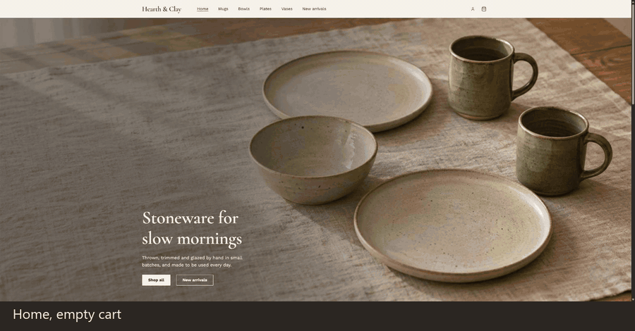
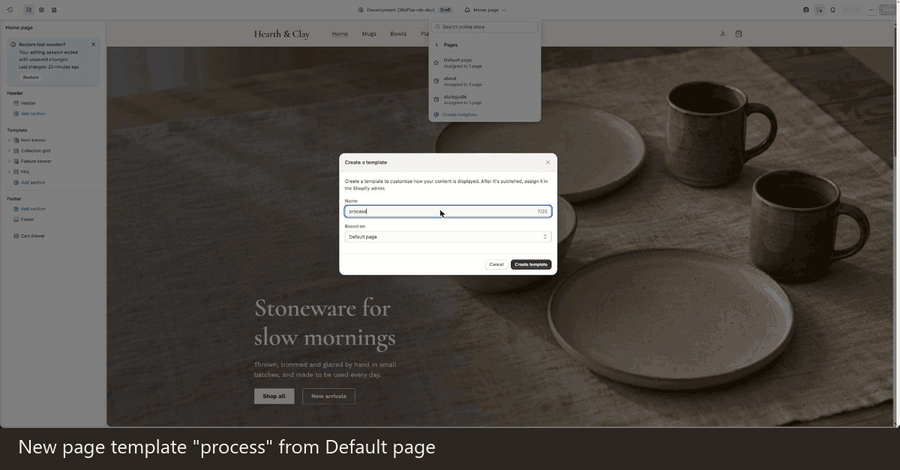

# Hearth & Clay — Online Store 2.0 sections case

**Live demo:** [os2-sections-demo.myshopify.com](https://os2-sections-demo.myshopify.com) · storefront password:
`tohcka`

Portfolio demo: a fictional brand and products; product and hero images were generated with Codex (OpenAI)
([details](docs/ai-assets.md)).

A custom Shopify theme for a fictional ceramics studio, built on Shopify's Skeleton theme: four content sections and a
rich-text utility section a merchant composes in the theme editor, a shared library of theme blocks, and an accessible cart drawer driven by the
Cart AJAX API with bundled section rendering.





**Problem and result.** A merchant needs landing pages they can build and rearrange without a developer, and
customers need a cart that never loses or misreports a change. The theme gives the merchant four content sections, a rich-text utility section and a library of
theme blocks with presets in the theme editor, and gives customers a cart drawer that keeps every change in order,
announces it to screen readers and falls back to the cart page whenever JavaScript or the network fails. Lighthouse on
the published theme: 95–100 performance, 100 accessibility, best practices and SEO ([quality.md](docs/quality.md)).

## Sections and theme blocks

| Section         | What the merchant controls                                                                     | Blocks                                                       |
| --------------- | ---------------------------------------------------------------------------------------------- | ------------------------------------------------------------ |
| Hero banner     | Desktop and mobile image, height, overlay, content position on a 3×3 grid, width, color scheme | `heading`, `text`, `button`                                  |
| Collection grid | Columns, image ratio, label on or under the image, product count, mobile grid or scroll row    | `_collection-card`                                           |
| Feature banner  | Image side, ratio, page-width or full-width layout, vertical alignment, color scheme           | `heading`, `text`, `button`, `group`, `list`, **app blocks** |
| FAQ accordion   | First question open, one open at a time, content width, color scheme                           | `_faq-item`, static `heading`                                |
| Rich text       | Content width, alignment, vertical padding, color scheme                                       | `group`, `heading`, `text`, `button`                         |

Shared theme blocks: `heading` (level and size set separately), `text` (eyebrow, small, body, large), `button`
(primary, secondary, link with arrow), `group` (row or column on the spacing scale) and `list` with `_list-item`.
Details: [sections.md](docs/sections.md), [blocks.md](docs/blocks.md). Design tokens, color schemes and contrast:
[design.md](docs/design.md); the style guide template (`page.styleguide.json`) renders every token and component in
each color scheme.

The store pages are also part of the theme: header with a mobile menu, footer, collection page with pagination,
product page with a variant picker, cart page.

## Architecture decisions

Full list with reasons and shopify.dev references: [decisions.md](docs/decisions.md).

- **Skeleton at a pinned commit, not Dawn.** Skeleton is the minimal theme Shopify's tooling starts from, so every
  component is written for this project instead of being trimmed out of Dawn. It is pinned at `a4f32d3`, the last
  commit with sections and JSON templates.
- **No Liquid developer preview.** Skeleton's current `main` composes templates with `` and
  `` from the Liquid July '26 developer preview. The theme uses only generally available Online Store
  2.0 features: sections, JSON templates and theme blocks.
- **Theme blocks with explicit types.** Sections list the block types they accept instead of `@theme`, so the block
  picker only offers blocks that fit. Blocks owned by one section are private (`_collection-card`, `_faq-item`,
  `_list-item`); the FAQ heading is a static block that can be edited but not removed.
- **App blocks in one place.** Only the feature banner accepts `@app`, so an app's output lands in a section designed
  for mixed content.
- **Bundled section rendering.** Every cart request returns the re-rendered drawer, cart count and screen reader
  message in the same response. Liquid is the only source of cart HTML; the script swaps markup and never builds it.
- **Cart changes in one queue.** Requests go out one at a time and quick quantity changes are coalesced, so the cart
  always ends at the quantity the customer last chose. On an error the drawer returns to the last state the server
  confirmed ([cart-drawer.md](docs/cart-drawer.md)).
- **Progressive enhancement.** Without JavaScript the product form posts to `/cart/add`, the cart page updates
  through its form, the mobile menu and the FAQ are native `<details>`, and the variant picker is a `<select>`.
- **Theme editor and Git.** `main` and `dev` are connected to the published and a draft theme; editor saves are
  commits. A page template in the repository (`templates/page.process.json`) is built only in the theme editor.

## Accessibility

WCAG 2.1 AA is the target. On every page type: 0 axe-core violations at desktop and mobile widths, every text and
button color pair in every scheme at 4.5:1 or more, keyboard access in visual order with a visible focus ring, focus
kept and returned by the cart drawer and the mobile menu, one polite announcement per cart change, and no motion with
`prefers-reduced-motion`. Checks and results: [quality.md](docs/quality.md).

## Local setup

Requirements: Node.js 22 or later, [Shopify CLI](https://shopify.dev/docs/storefronts/themes/tools/cli), a Shopify
store you can edit themes on.

```powershell
npm install
shopify theme dev --store <your-store>.myshopify.com
```

Checks, the same ones CI runs on pull requests:

```powershell
npm run format:check
npm run lint
shopify theme check
```

The demo catalog (14 products, 30 images, 5 collections) is loaded through the Admin API from `data/`. Copy
`.env.example` to `.env` and fill in a Dev Dashboard app's credentials, then:

```powershell
npm run catalog:seed:dry-run   # validate data/ offline
npm run catalog:seed           # create or update products, images and collections
npm run catalog:verify         # compare the store with data/
```

Menus are created by hand in the admin ([catalog.md](data/catalog.md)).

## Limitations and scope

- No collection filters, sorting, search suggestions or quick view; one language.
- The free-shipping progress in the cart drawer is shown only when the cart is in the store currency, because Liquid
  cannot convert the threshold between currencies.
- Discount codes are entered at checkout, not in the cart drawer.
- The demo catalog does not track inventory, so every variant can be added to the cart.
- No countdown timers, stock pressure, invented reviews, discount badges, pop-ups or autoplay carousels.

## License and provenance

- Original work is under the [MIT License](LICENSE).
- Files derived from Skeleton stay under Shopify's theme licence in [LICENSE.md](LICENSE.md); they are listed with the
  source commit in [third-party-assets.md](docs/third-party-assets.md), together with the Lucide icons.
- Product and hero images are AI-generated: [ai-assets.md](docs/ai-assets.md).
